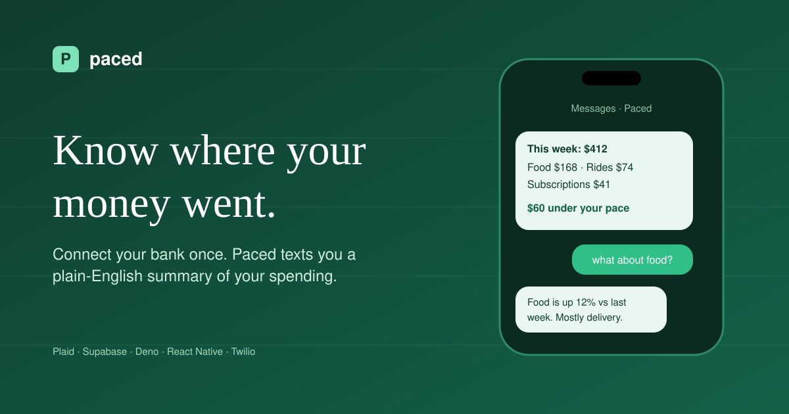
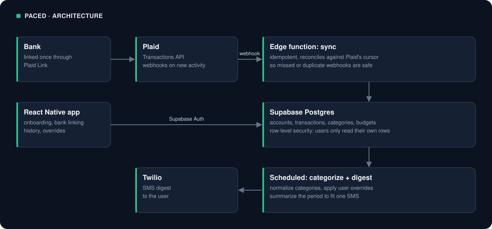

# Paced

A personal finance app that texts you where your money went, so you never have to open a dashboard.

**Status:** Private beta. Source is private; this repo documents the architecture and what I built.

## The problem

Budgeting apps fail because they require you to go look at them. Paced inverts that: it comes to you. Connect a bank account once, then get an SMS digest that tells you what you spent and where, with no app to open.

## How it works

React Native app for onboarding, account linking, and reviewing history. Everything else runs server-side on a schedule.

## Stack

| Layer | Technology |
|---|---|
| Mobile client | React Native, TypeScript |
| Auth | Supabase Auth |
| Database | Supabase Postgres with row-level security |
| Backend | Ten Deno edge functions on Supabase |
| Bank data | Plaid (Link, Transactions, webhooks) |
| Messaging | Twilio SMS |

## What I built

- **Plaid integration end to end** — Link token exchange, item storage, and webhook handling. Transactions sync incrementally off Plaid webhooks rather than polling, so the database stays current without burning API calls.
- **Ten Deno edge functions in production** — link token creation, public token exchange, webhook receiver, transaction sync, categorization, digest generation, SMS dispatch, account management, and scheduled triggers.
- **Postgres schema with row-level security** — accounts, transactions, categories, and budgets, with RLS policies so a user can only ever read their own rows. Access control lives in the database, not in application code.
- **Categorization layer** — normalizes Plaid's categories into a smaller set that reads well in a text message, with user overrides that persist.
- **Digest pipeline** — scheduled function aggregates the period's spend by category, formats it to fit an SMS, and hands it to Twilio.

## What I learned

- Webhooks are not reliable delivery. The sync function is idempotent and reconciles against Plaid's cursor so a missed or duplicated webhook does not corrupt the ledger.
- RLS is worth the upfront cost. Once the policies are right, every query is safe by default and I stopped writing per-endpoint authorization checks.
- SMS is a hard formatting constraint, and a good one. Fitting a month of spending into 300 characters forced the product to be opinionated about what actually matters.
- Deno edge functions have a cold-start and timeout budget. Long work belongs on a schedule, not in a request path.

## Roadmap

- Recurring-charge detection and alerts for price increases
- Weekly and monthly digest cadences alongside daily
- Shared household accounts
- Spending anomaly detection

---

Built by [Pranav Nepal](https://github.com/aomine97) · [LinkedIn](https://www.linkedin.com/in/pranavnepal)
